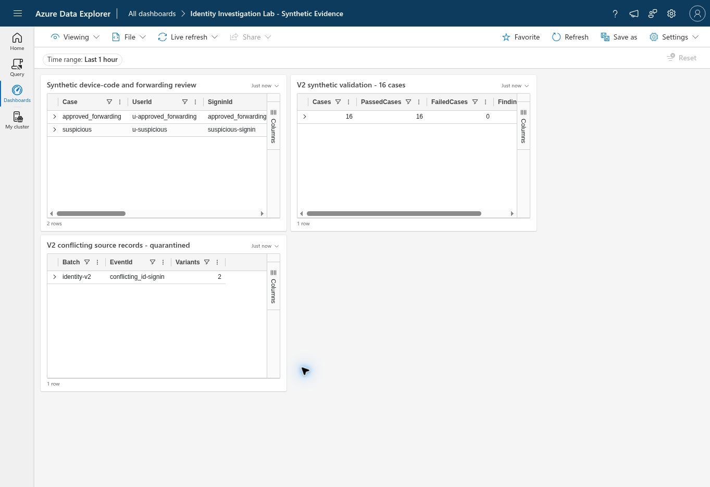

# Microsoft 365 identity investigation with KQL

A synthetic account-takeover investigation lab executed in Azure Data Explorer's free KQL engine. It investigates successful device-code authentication followed by forwarding-rule changes, tests misleading correlations and surfaces conflicting source records.

## Verified results

| Check | Observed result |
| --- | --- |
| Expanded fixture | 33 generated rows |
| Live KQL regression matrix | 16 passed, zero failed |
| Correlation | Six review candidates |
| Source quality | One conflicting ID with two variants |
| Standalone forwarding review | 12 changes |
| Dashboard | Three live tiles verified |

## Reproduce

1. Create a free Azure Data Explorer database.
2. Run detections/load-fixture.kql for the original two-row demonstration, if desired.
3. Run detections/load-fixture-v2.kql for the expanded fixture.
4. Run detections/validate-v2.kql. Expect 16 rows with Passed=true.
5. Run detections/validation-summary-v2.kql. Expect 16 passed, zero failed and six findings.
6. Inspect detections/data-quality-v2.kql and detections/forwarding-rule-review-v2.kql.

See [full instructions](docs/reproduce.md), [architecture](docs/architecture.md), [fixture schema](docs/fixture-schema.md), [case review](reports/regression-review.md), [response workflow](docs/response-playbook.md) and [release review](RELEASE_REVIEW.md).

[Watch the live dashboard refresh](demo/live-dashboard.mp4). The short recording contains actual browser screenshots sampled during refresh. It has no audio.

## Analyst judgment

A legitimate approved-forwarding case intentionally matches the rule. Same-account activity within a short interval supports investigation, not a verdict of phishing or token theft. A forwarding configuration does not establish that any email was delivered. Conflicting event IDs are surfaced and excluded from correlation.

## Scope and limits

All input events are generated and labelled synthetic. This is a live KQL execution lab, not a Sentinel deployment or an investigation of a real compromised tenant. No mailbox, session, credential or token was changed. The included native SigninLogs hunt remains unexecuted. Production accuracy is unmeasured.

The [access decision](docs/access-checklist.md) explains the no-card setup. [Sources](docs/sources.md) document Microsoft references. [Status](STATUS.md) distinguishes release deliverables from future extensions.

## Automated package validation

GitHub Actions runs scripts/check_package.py on pushes and pull requests. It checks fixture hashes, evidence labels, saved result counts, local Markdown links and common credential patterns. It does not execute KQL remotely or replace the saved live validation.
