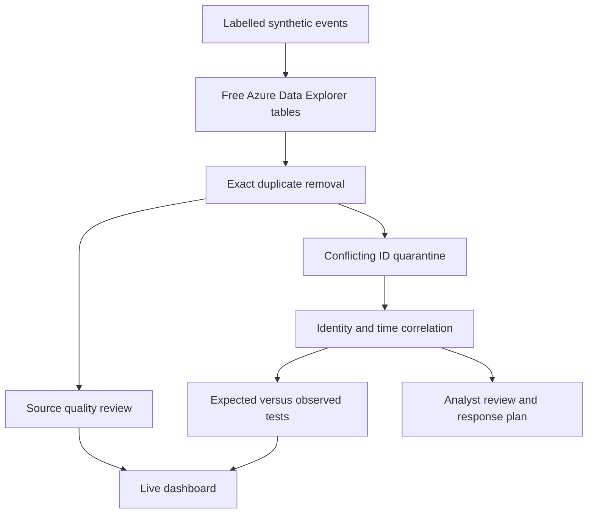

# Architecture

The correlation joins Batch and UserId, then checks the event interval. Case is used only to report fixture outcomes. No join establishes shared tokens or sessions. The standalone forwarding review can surface changes even when authentication cannot be correlated.
